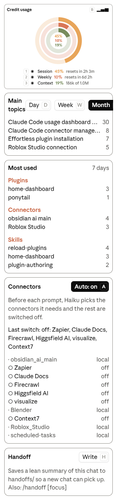

<p align="center"></p>

# Credit Dashboard for Claude



A Claude Code mod that opens a **Dashboard** pane beside your chat, in Claude's colours, with five cards:

- **Credit usage**: three rings, one inside another.
  - The outer ring is your **session** (5-hour) limit.
  - The middle ring is your **weekly** (7-day) limit.
  - The inner ring is how full the **context** window is.
  - Each meter has a toggle (◉ / ○) to hide or show it. The **▂▅▇** icon in the top right switches to a bar chart, and the same toggles apply to the bars.
- **Main topics**: your chat titles ranked by how many prompts you sent in each, with **Day / Week / Month** tabs.
- **Most used**: your top plugins, connectors and skills over the last 7 days.
- **Connectors**: every MCP server in the chat and whether it's on. Press **Auto** (or type `/auto-connectors on`) to switch claude.ai connectors automatically: before each prompt, Haiku picks the ones the prompt needs, turns those on and turns the rest off. A connector used in the last 3 prompts stays on. Off by default, and the choice is remembered.
- **Handoff**: the **Write** button (or `/handoff [focus]`) saves a lean markdown summary of the chat (goal, state, decisions, files, essential code, commands, next steps) to `handoffs/` in the working folder, so a new chat can pick up with `Read <path> and continue`.

The first three cards run entirely on your machine and use no credits: the meters come from usage figures the session already has, and the rest is counted from your local chat history (`~/.claude/projects`). Two features do call the model: **Auto** connectors makes one small Haiku call per prompt, and **Handoff** makes one call over the chat each time you use it.

## Token use

| Feature | When it runs | Tokens |
| --- | --- | --- |
| Credit usage, Main topics, Most used, Connectors list | Always | **0**: read from local files and the session's own usage figures |
| Auto connectors, **off** (the default) | Never | **0** |
| Auto connectors, **on** | Once per prompt you send (not `/` commands) | One **Haiku** call: about 80 tokens of instructions and connector names plus your prompt (capped at about 1,000 tokens), and a reply of about 10 tokens (200 at most). It also adds about 65 tokens to the main model's system prompt, which is cached after the first request. |
| Handoff | Only when you press Write or run `/handoff` | One call on your **current model** over the whole chat. Most of that input is the chat itself, already cached, so it's billed at the cheaper cached rate. On top of that: about 260 tokens of instructions and 1,000–3,000 tokens for the document it writes. |

So with Auto on, a typical short prompt costs about 150–400 extra Haiku tokens. Haiku is the cheapest Claude model, and its tokens count toward your usage limits the same way your main model's do.

## Install

Type this at the prompt of a terminal Claude Code session:

```
/plugin install home-dashboard --marketplace imnotnikos/Credit-Dashboard-for-Claude
```

Answer `y` to add the marketplace, then pick the **user** scope. Once installed at user scope, it also loads in the Claude desktop app's Code tab.

## Use

The pane opens when a session starts. Type `/home-dashboard` to reopen it, or `/handoff` to write a handoff.

Turn automatic connector switching on or off from the chat with `/auto-connectors on` or `/auto-connectors off` (no argument flips it). Your choice is remembered for new chats.

Handoffs save to `handoffs/` in the chat's working folder. To save them somewhere else (an Obsidian vault, say), set **Handoff folder** in the plugin's options in `/config`, or add this to `~/.claude/settings.json`:

```json
"pluginConfigs": {
  "home-dashboard@home-dashboard": { "options": { "handoffDir": "E:/Notes/Handoffs" } }
}
```

With the pane focused, these keys work:

| Key | Action |
| --- | --- |
| `1` / `2` / `3` | Toggle the session / weekly / context meter |
| `b` | Switch between rings and bars |
| `d` / `w` / `m` | Show topics for the last day / week / month |
| `a` | Turn automatic connector switching on or off |
| `h` | Write a handoff |

## Notes

- The meters show "—" until the first reply of a session, because that's when usage figures arrive.
- claude.ai connectors are only stored by an ID, so each one is named after a word its tools share (for example "Firecrawl").
- History files over 4 MB are skipped.
- Auto only switches claude.ai connectors. Local servers (your MCP config, desktop extensions, plugin servers) show as `local` and are left alone, because the only switch Claude Code exposes is for claude.ai connectors.
- Switching a connector also changes the default for new chats, the same as the Connectors menu does. In default permission mode, each switch asks for approval.
- A connector Auto turns on may only become usable from the next turn.
